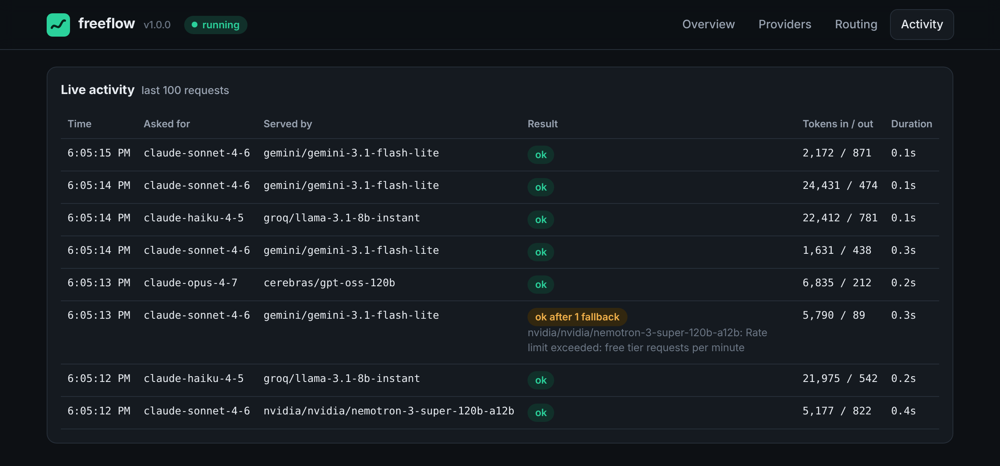
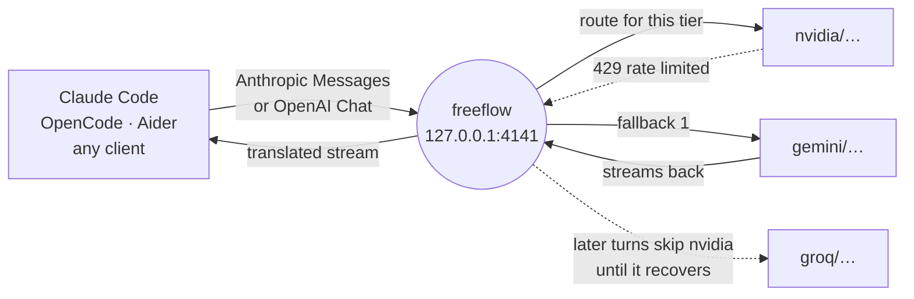
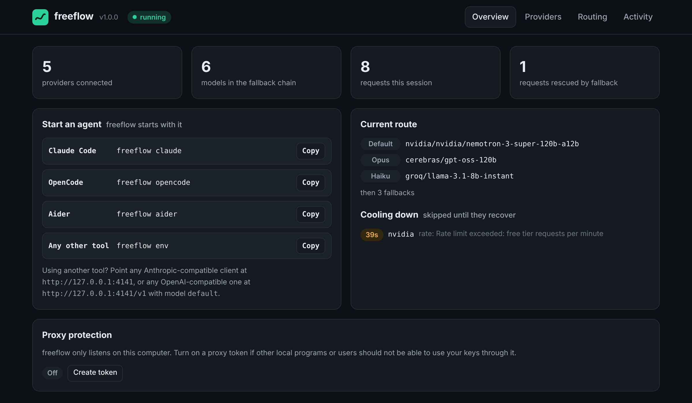
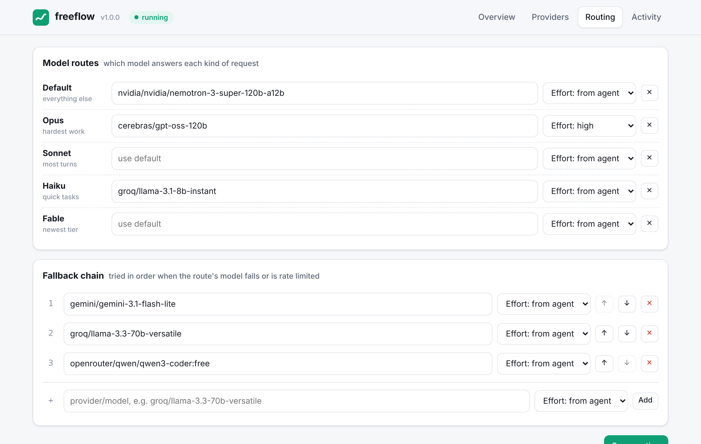

<div align="center">


# freeflow

**Keep coding when the free tier runs out.**

One local gateway that lets Claude Code, OpenCode, Aider and any other coding agent use 58 model providers, free tiers first.
When a provider hits its limit, freeflow moves your request to the next one before your agent notices.

[](https://github.com/Ethos6/freeflow/actions/workflows/ci.yml)
[](LICENSE)


[Quick start](#quick-start) · [How it works](#how-it-works) · [Providers](docs/providers.md) · [Clients](docs/clients.md) · [Security](#security) · [FAQ](#faq)



<sub>The activity view with sample traffic: one turn hit NVIDIA's rate limit and was served by Gemini instead.</sub>

</div>

## Why freeflow

Free model tiers are generous, but each one stops you somewhere: a requests-per-minute cap, a daily quota, a busy afternoon. A coding agent that stalls in the middle of a task is worse than a slower model that keeps going.

freeflow sits between your agent and the providers. You pick a model for each kind of request and a chain of fallbacks from *different* providers. Every request goes down that chain until one answers. A provider that just failed rests for a while, so the next turn goes straight to one that works.

- **No stalls.** Rate limits, outages, bad keys and timeouts trigger a fallback before your agent sees a single byte. `Retry-After` is honoured, and providers that keep failing back off exponentially.
- **58 providers, one model list.** NVIDIA NIM, OpenRouter, Groq, Gemini, Cerebras, Mistral, Cohere, Hugging Face, Cloudflare, DeepSeek, Kimi, Z.ai, Qwen, xAI, OpenAI, Anthropic and more, plus Ollama, LM Studio, llama.cpp and your own endpoints. [Full list](docs/providers.md).
- **Your agent works as designed.** Streaming, tool calls, parallel tools, images, thinking blocks and token counts are translated faithfully. Tested end to end with the real Claude Code CLI.
- **Self-healing requests.** If a provider rejects a parameter it doesn't support (`stream_options`, `reasoning_effort`, `max_tokens`…), freeflow removes it, retries, and remembers for next time.
- **A dashboard you'll actually open.** Add keys, browse each provider's models, set routes and fallbacks, and watch every request live, including which ones were rescued.
- **Small and auditable.** Zero runtime dependencies, about 2,300 lines of plain JavaScript checked by TypeScript. Read it in an evening.

## Quick start

You need [Node.js 22 or newer](https://nodejs.org).

```bash
npm install -g github:Ethos6/freeflow
freeflow open          # opens the dashboard in your browser
```

1. In **Providers**, paste a key for one or more providers. The free ones are listed first; most keys take a minute to create.
2. In **Routing**, pick a default model and add two or three fallbacks from other providers. Or use the *Load models* button on any provider and click **default** / **+ fallback**.
3. Start your agent:

```bash
freeflow claude        # Claude Code
freeflow opencode      # OpenCode
freeflow aider         # Aider
```

That's it. The launcher starts freeflow in the background if it isn't running, points the agent at it, and passes any extra arguments through (`freeflow claude --resume`, `freeflow claude -p "fix the tests"`).

<details>
<summary><b>Prefer the terminal?</b> Everything works without the dashboard.</summary>

```bash
freeflow key groq                                    # paste the key when asked
freeflow key nvidia
freeflow use groq/llama-3.3-70b-versatile            # default route
freeflow use nvidia/qwen/qwen3-coder-480b-a35b-instruct --tier opus --effort high
freeflow fallback add nvidia/nvidia/nemotron-3-super-120b-a12b
freeflow doctor                                      # sends a tiny request to every configured model
freeflow claude
```

Keys can also come from the environment (`GROQ_API_KEY`, `NVIDIA_NIM_API_KEY`, …); the variable for each provider is in [docs/providers.md](docs/providers.md).

</details>

## How it works



**Routes.** Claude Code asks for `opus`, `sonnet`, `haiku` or `fable` models; freeflow maps each tier to the model you chose, or to your default. You can also name a model directly: `freeflow claude --model groq/llama-3.3-70b-versatile`, or switch mid-session with `/model cerebras/gpt-oss-120b`.

**Fallbacks.** If the route's model fails before producing output, the request moves down your fallback chain: route → default → fallback 1 → fallback 2 … Failures are classified: rate limits and bad keys put the whole *provider* in a cooldown, an unknown model only cools down that *model*, and a request one provider rejects as invalid (say, too long for its context) still gets a chance on the next model but cools nothing down.

**Read-ahead.** freeflow waits for the provider's first real output (text, thinking or a tool call) before it starts answering your agent. Until then a failure can still fall back invisibly. If a provider dies mid-answer, the agent gets a standard `overloaded_error` and retries the turn on its own.

**Translation.** Agents speak the Anthropic Messages API; almost every provider speaks OpenAI Chat Completions. freeflow converts between them, including:

| Anthropic side | Provider side |
| --- | --- |
| system blocks, text, images, documents | system / user messages, `image_url` parts |
| `tool_use` / `tool_result` (results first, as providers require) | `tool_calls` / `tool` messages |
| `tool_choice` any / tool / none, `disable_parallel_tool_use` | `required` / function / `none`, `parallel_tool_calls` |
| `thinking` budget or effort | `reasoning_effort` or OpenRouter `reasoning`, per provider |
| `thinking` blocks in the answer | `reasoning_content`, `reasoning`, or `<think>…</think>` in the text |
| `stop_reason`, usage, cache reads | `finish_reason`, usage, `cached_tokens` |

It also handles the details that break naive proxies: MCP tool names longer than 64 characters, Mistral's nine-character tool ids, Gemini's thought signatures on tool calls, tool calls streamed without an index, malformed tool arguments, providers that ignore `stream: true`, and in-stream error events. Anthropic itself is forwarded natively, with no translation.

## Clients

| Client | How |
| --- | --- |
| Claude Code (terminal) | `freeflow claude` |
| Claude Code in VS Code / JetBrains | run `eval "$(freeflow env)"` in the shell you start the editor from, or set `ANTHROPIC_BASE_URL` in Claude Code's settings |
| OpenCode | `freeflow opencode` |
| Aider | `freeflow aider` |
| Cline, Roo, Continue, Kilo Code, Zed, Cursor (custom OpenAI endpoint), LibreChat, scripts | base URL `http://127.0.0.1:4141/v1`, any API key (or your proxy token), model `default` or any `provider/model` |
| Anthropic SDKs and tools | base URL `http://127.0.0.1:4141` |

Details and settings snippets: [docs/clients.md](docs/clients.md).

## The dashboard

<table>
<tr>
<td></td>
<td></td>
</tr>
</table>

Open it with `freeflow open` (or browse to `http://127.0.0.1:4141`). It shows connected providers, the current route, which providers are cooling down and why, a searchable catalog of all 58 providers with one-click model lists and a test button, a routing editor with per-model reasoning effort, and a live activity feed.

## Security

freeflow holds your API keys, so it is careful with them:

- It listens on `127.0.0.1` only, and refuses requests whose `Host` header isn't a local name, which blocks DNS-rebinding attacks from web pages.
- Web pages can't use it behind your back: cross-site requests to the API are refused.
- The dashboard is only ever served to the machine running freeflow, even if you open it up to your network, and its API needs a random admin token and same-origin requests. It never returns a key in full.
- Other machines can only use the API after you turn on the proxy token.
- Keys are stored in `~/.freeflow/config.json`, written atomically with owner-only permissions (`0600`).
- The dashboard is served with a strict Content-Security-Policy and cannot be framed.
- Optional **proxy token**: turn it on in the dashboard and every `/v1` request must carry it (`Authorization: Bearer …` or `x-api-key`). The launchers pass it automatically.
- No telemetry. freeflow only talks to the providers you configure.

Found a problem? See [SECURITY.md](SECURITY.md).

## Fair use

freeflow uses **one key per provider** and never rotates accounts or keys to get around a provider's limits. When a provider says "slow down", freeflow listens: it honours `Retry-After`, backs off, and uses another provider you have legitimately signed up for. Several coding plans are for personal, interactive use only; please follow each provider's terms.

## Configuration

| | |
| --- | --- |
| Config file | `~/.freeflow/config.json` (override the folder with `FREEFLOW_HOME`) |
| Port | `4141` · change with `freeflow config port 5151` |
| Host | `127.0.0.1` · to serve your LAN: turn on the proxy token, run `freeflow config host 0.0.0.0`, and set `FREEFLOW_ALLOWED_HOSTS` to the name or IP clients use. The dashboard stays local-only. |
| Timeouts | `timeouts.firstByteMs` (default 120 s) and `timeouts.idleMs` (180 s) in the config file |
| Server log | `~/.freeflow/server.log` when started by a launcher; `freeflow start` logs to the terminal |

Commands: `freeflow help`.

## Testing

Every change runs through:

- **Unit and integration tests** (`npm test`): translation edge cases, routing and cooldowns, error classification, SSE parsing, and a full server against a scripted fake provider (fallback, timeouts, mid-stream failures, cancelling provider streams when the client hangs up, parameter repair, native Anthropic forwarding, admin API, DNS-rebinding, cross-site and token checks).
- **SDK conformance** (`npm run test:sdk`): the official Anthropic and OpenAI SDKs consume freeflow's streams, tool calls, thinking blocks and errors.
- **Real Claude Code end to end** (`npm run test:e2e`): `freeflow claude -p …` runs the actual Claude Code CLI, which writes a file through a tool call. The first provider is rate limited, so the run also proves fallback; a second run checks `--model provider/model`.
- **Type checking** (`npm run typecheck`) with TypeScript in strict mode.

CI runs these on Linux, macOS and Windows.

## FAQ

**Is it really free?** freeflow is free and open source. The models are as free as the providers make them: many offer free tiers or free models with rate limits. With a few of them in your fallback chain, you hit a wall far less often. Paid and local providers work exactly the same way.

**Will quality match Claude?** It depends on the models you choose. Strong open models (Qwen3 Coder, Kimi, GLM, DeepSeek, gpt-oss) handle a lot of everyday coding well; route your hardest work (`opus`) to the strongest model you have.

**Does it work with my Claude subscription?** No. freeflow is for API keys and local models. If you add an Anthropic API key, Claude models are forwarded natively and can sit in the same fallback chain as everything else.

**Can I mix local and cloud models?** Yes. For example, use Ollama for `haiku` (quick background tasks) and a cloud model for everything else, or put a local model last in the chain as a safety net.

**What about Codex?** Recent Codex versions use OpenAI's Responses API, which freeflow does not implement yet. Any tool that can use a custom OpenAI Chat Completions endpoint works today.

## Credits

freeflow is an independent project by [Ethos 6](https://github.com/Ethos6). The idea of running coding agents on free model tiers was popularised by [free-claude-code](https://github.com/Alishahryar1/free-claude-code) by Ali Khokhar, which has a far wider scope (desktop apps, messaging bots, voice, browser sessions). freeflow was written from scratch with a different focus (fallback chains, health tracking, zero dependencies) and shares no code with it. Provider endpoints are public information from each provider's documentation.

Claude and Claude Code are trademarks of Anthropic. freeflow is not affiliated with or endorsed by Anthropic or any provider listed here.

## License

[MIT](LICENSE) © 2026 Ethos 6
